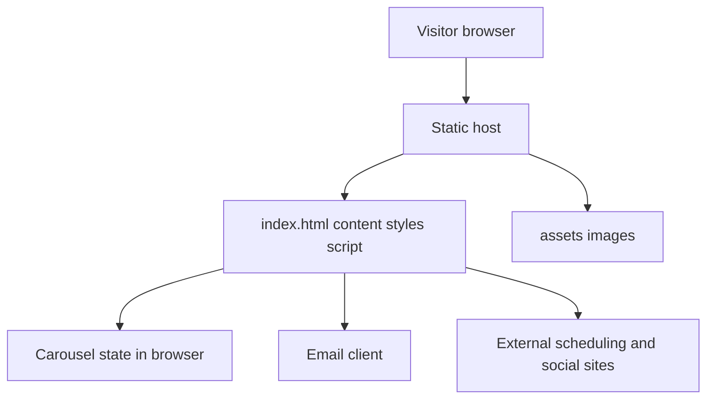
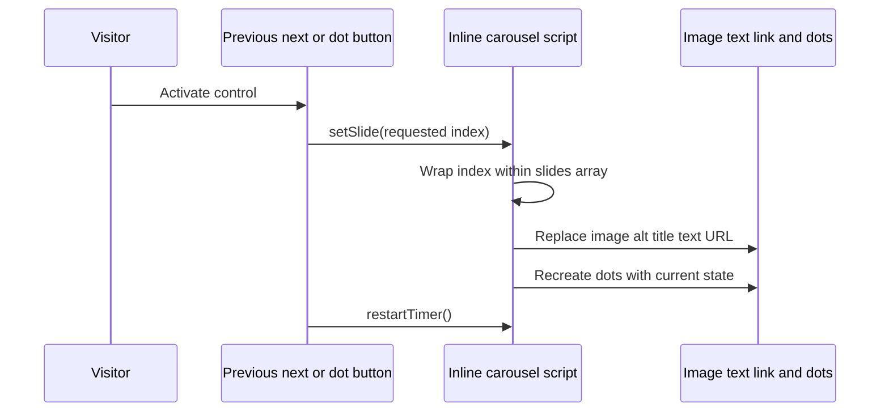
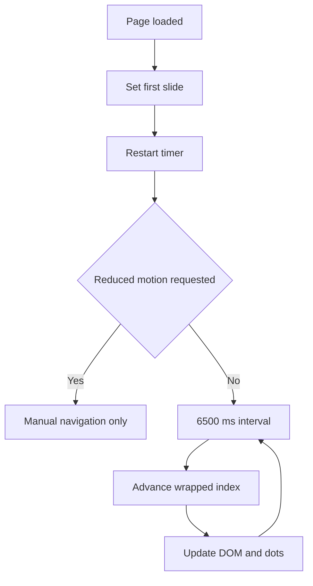

# Architecture

## Page, assets, and external services

`index.html` contains three concerns: document content, CSS in a style block, and JavaScript in a script block near the end of the body. This keeps deployment simple but makes the file a shared editing surface. A layout change can be close to a carousel change, so review the diff carefully and avoid broad formatting rewrites during a small content correction.

The static host only needs to serve files with appropriate content types. The browser renders HTML and CSS, fetches referenced images, and executes the slideshow. Contact and scheduling links navigate to other applications. There are no API routes, webhooks, environment variables, database schemas, or background jobs in this repository.

## Carousel data contract

The `slides` array contains objects with `image`, `alt`, `title`, `text`, and `url`. The image path is relative to the page. `alt` provides an accessible description. `title` and `text` describe the selected example. `url` links to its external source. Keep these fields describing the same property or example; an image and headline mismatch is a content defect even when the code runs.

`activeSlide` stores the current array index. `setSlide(index)` wraps the index with modulo arithmetic so previous on the first slide moves to the last. It then writes the image source and alternative text, visible title and text, and destination link, before rebuilding the dot controls.

`renderDots()` clears the dot container and creates one button per slide. Each has a `Show photo N` accessible label and `aria-current` reflecting the selected state. Clicking a dot calls `setSlide` and restarts the timer.

## Timer and accessibility boundary

`restartTimer()` clears the previous interval. Unless `prefers-reduced-motion: reduce` matches, it schedules the next slide every 6500 milliseconds. Manual navigation also restarts that interval. Startup calls `setSlide(0)` and then `restartTimer()`.

The reduced-motion check happens when restarting; a preference change while the timer is already running is not subscribed to. The script also recreates dot buttons each time, so keyboard focus behavior deserves manual attention when using a dot. There is no explicit pause control or visibility-change handler. These are concrete usability improvement candidates, not reasons to replace the entire site framework.

## Ownership of information

Git owns the approved website source and static media. The visitor's browser owns temporary slideshow position. External providers own appointment and social interactions. An email client owns composing and sending a message. There is no internal lead record to back up or query. A future CRM integration must introduce an explicit consent, delivery, retention, and error contract rather than treating an outbound link click as a completed sale inquiry.
